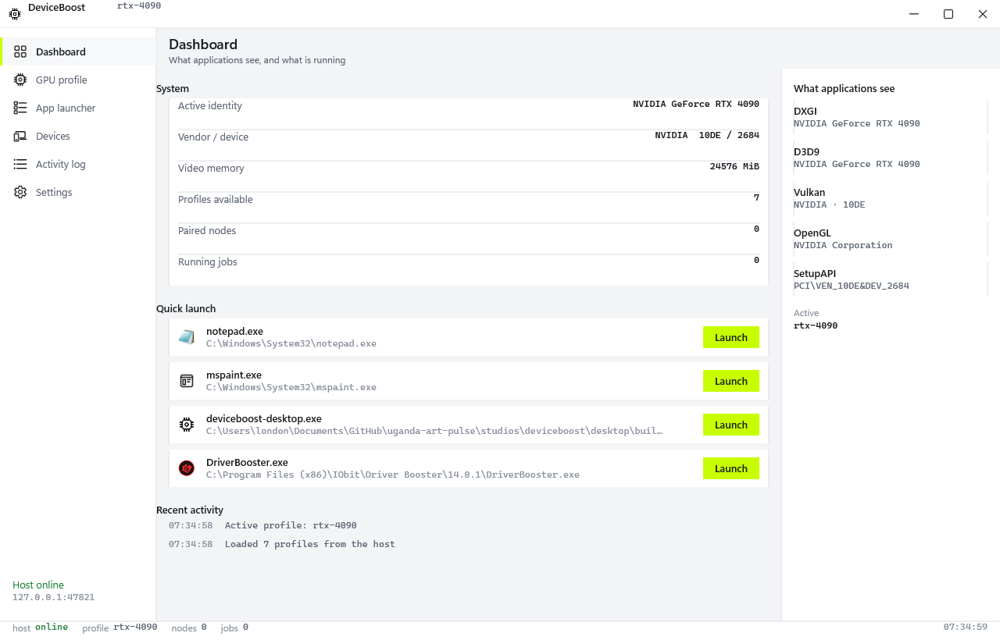
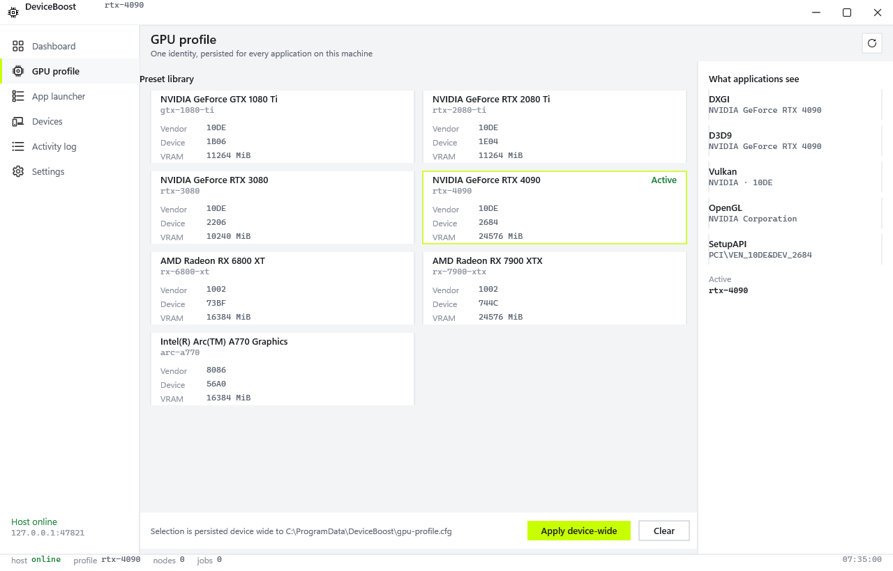
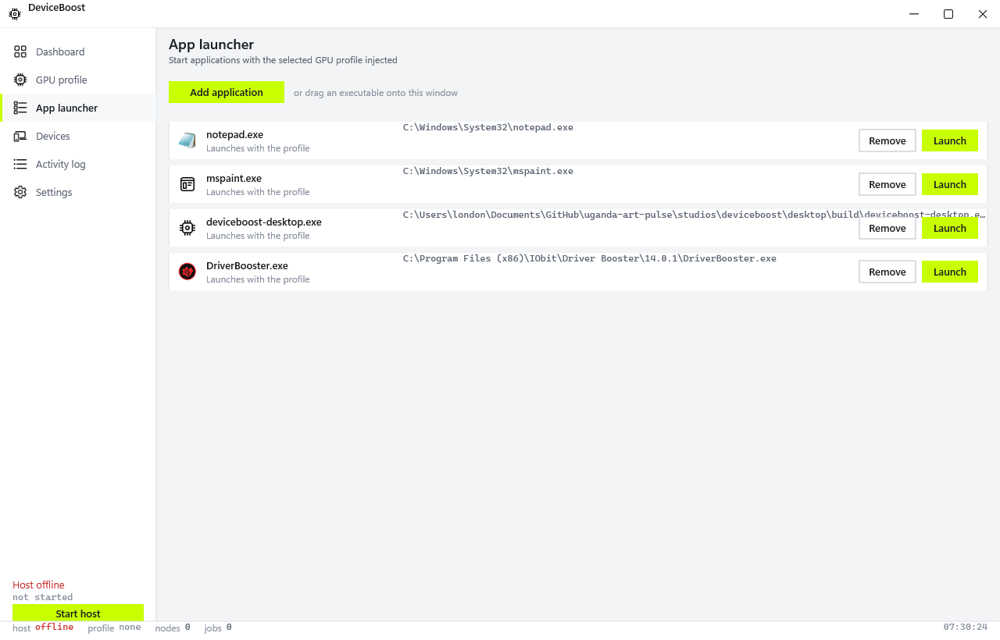
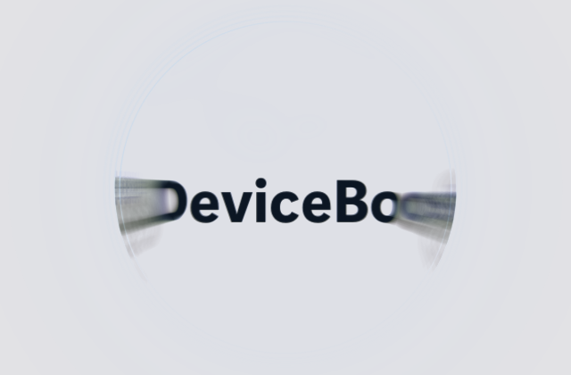

# DeviceBoost

  

<h1 align="center">DeviceBoost</h1>

  A Windows desktop companion that presents a chosen GPU identity to your applications, with a native interface for profiles, app launching and node management.

  
  
  

---

DeviceBoost lets you select a GPU identity, such as an NVIDIA GeForce RTX 4090, and have hooked applications report that identity instead of your real card. It ships as a complete stack: a native Windows client, a host service with a local API, a launcher that starts your applications with the identity hooks injected, and the proxy libraries that make the spoof visible to popular graphics APIs.

The client is a real Windows application built with Direct2D, DirectWrite and Direct3D 11. No web view, no third-party UI framework.

## Features

- **GPU identity profiles.** Seven built-in presets covering NVIDIA GeForce (GTX 1080 Ti to RTX 4090), AMD Radeon (RX 6800 XT, RX 7900 XTX) and Intel Arc (A770), each with real vendor id, device id and video memory values. Custom identities can be defined from the command line with your own vendor and device ids.
- **Device wide persistence.** The selected identity is written to a single configuration file that every hooked application reads, so the spoof is consistent across processes and reboots.
- **Per API reporting.** Hook seams cover DXGI, Direct3D 9, Vulkan, OpenGL and Windows SetupAPI, so applications see the same vendor, device and memory values regardless of which graphics API they query.
- **One click launching.** Add any executable to the launcher, and DeviceBoost deploys its proxy libraries next to that application and starts it with the identity hooks injected. Real application icons are extracted and cached automatically.
- **Safe deploy rules.** Protected system directories are refused, unknown existing DLLs are never overwritten, and the launcher never claims an identity it did not verify.
- **Node pairing and job offload protocol.** The host issues single-use, time limited pairing tokens for Android nodes (API level 23 or newer) and runs a checksum verified job protocol, currently covering H.265 video transcoding with balanced and quality presets.
- **Native activity log.** Every host transition, profile change and launch is recorded with timestamps in a monospace feed.
- **Live status model.** The client polls the host API every two seconds, keeps the last known data on screen when the host goes away, and marks it stale until the connection returns.
- **Polished native UI.** Light theme, a single lime accent, square corners, sentence case everywhere, real Fluent icons, and an opening liquid glass logo animation.

## Screenshots

### Dashboard

### GPU profiles

### App launcher

### Opening splash

  
  

More screenshots live in [`assets/screenshots/`](assets/screenshots/).

## Download

The latest release is available on the [GitHub Releases page](https://github.com/LordeStudios/DeviceBoost/releases/latest).

| Asset | Size | Contents |
|---|---|---|
| `DeviceBoost-0.1.0-win-x64.zip` | 2.8 MB | Portable bundle, all five binaries |
| `SHA256SUMS.txt` | small | SHA-256 checksums for every artifact |

The bundle contains:

| File | Purpose |
|---|---|
| `deviceboost-desktop.exe` | The native Windows client (2.1 MB) |
| `deviceboost-host.exe` | The host service with the local API (1.8 MB) |
| `deviceboost-launcher.exe` | Starts applications with the hooks injected (1.2 MB) |
| `deviceboost_hook.dll` | The identity hook library (1.3 MB) |
| `deviceboost_proxy.dll` | The proxy library deployed as `dxgi.dll` / `d3d9.dll` (1.3 MB) |

## Installation

1. Download `DeviceBoost-0.1.0-win-x64.zip` from the [releases page](https://github.com/LordeStudios/DeviceBoost/releases/latest).
2. Verify the download against `SHA256SUMS.txt` if you wish.
3. Extract the folder anywhere you like, for example `C:\Tools\DeviceBoost`.
4. Run `deviceboost-desktop.exe`. The client starts the host on demand, or you can start it yourself with `deviceboost-host.exe start-host`.

No installer, no registry entries, no services. The folder is fully portable.

## System requirements

- Windows 10 (1809 or newer) or Windows 11, 64 bit.
- A GPU with a WDDM 2.x driver.
- Roughly 30 MB of disk space.

The client renders on any GPU; the opening animation uses a software renderer first and hardware acceleration when available, so it works on integrated graphics too.

## Compatibility

- Windows 10 and Windows 11, x64 only.
- Applications report the spoofed identity through DXGI, Direct3D 9, Vulkan, OpenGL and SetupAPI.
- The client talks to the host on `127.0.0.1:47821` (HTTP) and `127.0.0.1:47820` (binary protocol). Nothing listens on external interfaces.

## Roadmap

- **DeviceBoost mobile app for Android.** The host pairing protocol, node registry and the job offload engine are implemented and tested today; the companion app that pairs a phone as a compute node is the next deliverable. The desktop Devices screen already shows the pairing flow.

## Release history

See the [releases page](https://github.com/LordeStudios/DeviceBoost/releases) for versioned downloads and notes. Changes are also tracked in [`CHANGELOG.md`](CHANGELOG.md).

## Security

If you discover a vulnerability, please use [GitHub's private vulnerability reporting](https://github.com/LordeStudios/DeviceBoost/security/advisories/new) rather than a public issue. Do not include credentials or exploit steps in public posts.

## Support

- Questions and help: the [issue tracker](https://github.com/LordeStudios/DeviceBoost/issues) (please search before opening a new issue).
- Bug reports: [open an issue](https://github.com/LordeStudios/DeviceBoost/issues/new) with your Windows version and the affected application.
- Feature requests: the same issue tracker, tagged `enhancement`.

## Publisher

**Lorde Studios.** Official organization: [github.com/lordestudios](https://github.com/lordestudios).

DeviceBoost is proprietary software. The repository distributes builds and documentation only; the source code is not public. Third party components keep their own licences, see the notes below.

### Third party components

- Icons: Microsoft Fluent UI System Icons (`@fluentui/svg-icons` 1.1.345), MIT licence, rasterized from the original SVGs.
- Splash animation: effect ported from the open source reactdrops `liquid-glass-logo` reference (ReactDrops Component Licence).
- Runtime: statically linked Rust and C++ standard libraries; no third party runtime DLLs are required.
